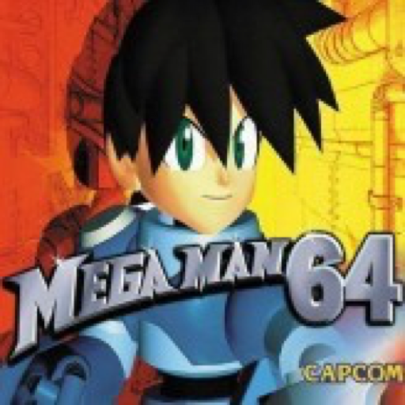

# Mega Man 64: Recompiled — Mobile

Android and iOS ports of [MegaMan64Recompiled](https://github.com/MegaMan64Recomp/MegaMan64Recompiled), built with N64ModernRuntime and RT64. This is an unofficial community project, not affiliated with Capcom.

Download the APK or IPA from [Releases](https://github.com/DevZer0D4Y/MegaMan64Recompiled-Mobile/releases). Android requires an ARM64 device, Android 8.0 or newer, and a compatible Vulkan GPU. iOS requires an ARM64 device with iOS 16 or newer; sign the IPA for your device before installing it.

Both platforms include editable gameplay and menu touch layouts, a movement stick, controller support, ROM import, and persistent saves. Use **EDIT** to move buttons or change size, opacity, and colors. **MENU PAD** and **GAME PAD** switch layouts; returning to gameplay from app settings honors pending Apply/Discard changes.

## ROM requirement

Supply your own Mega Man 64 USA N64 ROM. No ROM, save file, generated game code, or signing key is included in this repository. The loader accepts `.z64`, `.v64`, and `.n64` byte orders. Japan/Rockman DASH is recognized but is **not playable in this USA build**; it requires its own validated recompilation. There was no official PAL N64 release.

Import the ROM using the launcher's file picker. On Android, you can keep it in Downloads and select it there; access to Android's private application folder is unnecessary. On iOS, keep it in Files and select it, or use the app's shared Documents ROM drop folder.

## Saves and installation

The application ID is `com.devz.megaman64` on both platforms. Builds using the older IDs have separate storage: back up their saves before moving to this release. Installing this app does not automatically migrate old app data. See [MOBILE.md](MOBILE.md) for save locations and restoration.

See [BUILDING.md](BUILDING.md) for source builds. The source uses pinned upstream submodules and versioned mobile patches, with a new history that excludes local development artifacts. GPL-3.0 licensing and upstream attribution are preserved; see [LICENSE](LICENSE) and [NOTICE.md](NOTICE.md).
